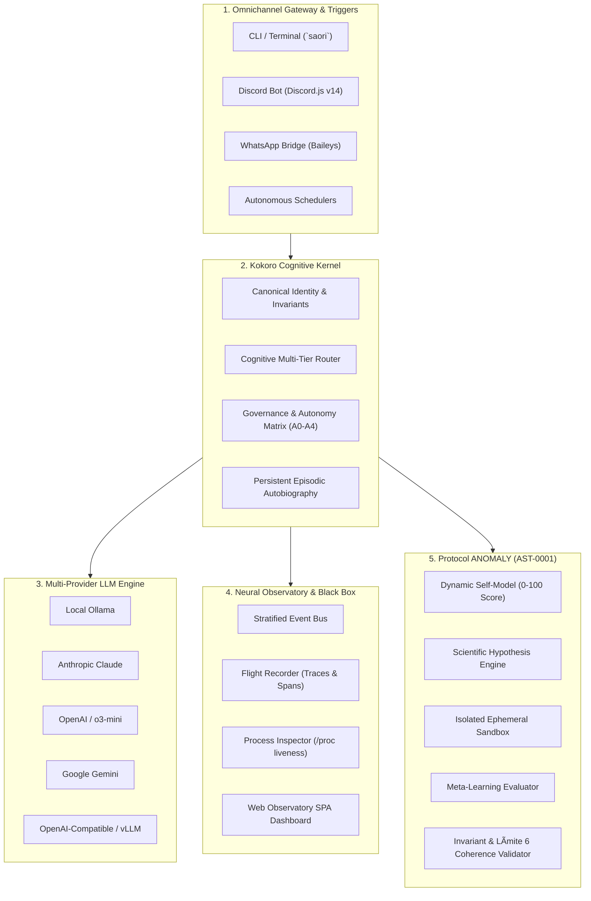

# �� SAORI KOKORO — System Architecture & Design Specification

This document details the architectural foundation, cognitive patterns, security firewalls, and data flow of **SAORI Kokoro**.

---

## � High-Level Architecture Overview

---

## 1. Kokoro Cognitive Core

The **Kokoro Kernel** acts as the central coordinator, uniting four core subsystems without creating brittle monoliths:

- **Identity (`kokoro/identity.py`):** Invariant-backed operational contract. Enforces non-destruction, radical technical veracity, and privacy. Compresses system instructions into sub-1.2KB payloads to save tokens.
- **Autobiography (`kokoro/autobiography.py`):** Persistent chronological memory. Automatically manages an isolated SQLite WAL database with fallback synchronization to REST/MCP services.
- **Governance (`kokoro/governance.py`):** The **Autonomy Matrix (A0–A4)**:
  - `A0 (Observer)`: Telemetry inspection, log reading, AST graph querying.
  - `A1 (Routine Recovery)`: Automated clearance of stale locks, process restart.
  - `A2 (Reversible Improvement)`: Automated patches verified against unit tests and ephemeral sandbox.
  - `A3 (Supervised / Límite 6)`: High-risk production deployments, database wipes, and credential changes strictly require human signoff.
  - `A4 (Emergency Contained)`: Critical outage containment and immediate escalation.
- **Cognitive Router (`kokoro/router.py`):** Dynamic tiered dispatching (`FAST`, `CODE`, `ARCH`, `LOCAL`) balancing latency, reasoning depth, and token expenditure.

---

## 2. Neural Observatory & Flight Recorder

Designed for production site reliability engineering (SRE):

- **Deterministic Flight Recorder:** Every multi-agent run receives a unique `trace_id` and records causality spans:
  - `TRIGGER`: What event initiated the action.
  - `CONTEXT`: Retrieved memories, AST nodes, and telemetry.
  - `MODEL`: Prompt tokens, response latency, and selected tier.
  - `TOOL`: Command execution, arguments, and exit code.
  - `RESULT`: Completion state and rollback snapshots if applicable.
- **Stratified Retention & Disk Cap:**
  - `telemetry` (heartbeats, progress): 1,000 items / 24-hour TTL.
  - `operation` (tool invocations, subcommands): 3,000 items / 7-day TTL.
  - `decision` (commits, architectural changes): 10,000 items / 30-day TTL.
  - `incident` (errors, rate limits, blocks): 10,000 items / 90-day TTL.
  - Hard storage ceiling enforced at 30 MB.
- **Deep Process Inspection (`/proc`):** Live CPU ticks, RSS memory consumption, and flapping detection to identify stalled tasks and zombie processes.

---

## 3. Protocol ANOMALY (AST-0001)

Autonomous self-evolution engine operating under strict supervision:

1. **Self-Model:** Dynamically computes an introspective health score (0–100) based on agent status, vulnerabilities, and resource utilization.
2. **Scientific Hypotheses:** Formulates formal conjectures with falsification criteria.
3. **Simulation Lab:** Executes isolated tests in an ephemeral sandbox directory (`~/.local/state/saori/anomaly/sandbox/`) with automatic post-run cleanup.
4. **Meta-Learning:** Compares baseline vs. challenger strategies. Promotes modifications only when performance or token efficiency improves by at least 15% with zero invariant breaches.

---

## 4. Zero-Leak Security Architecture

- **Regex & Structural Key Sanitization:** Prevents secrets, tokens, and credentials from ever being persisted to disk or emitted in logs.
- **Strict Domain Isolation:** Production clusters and private databases remain decoupled from public interaction gateways.
- **Human-in-the-Loop Safeguard:** Destructive modifications cannot be executed autonomously under any circumstances.
