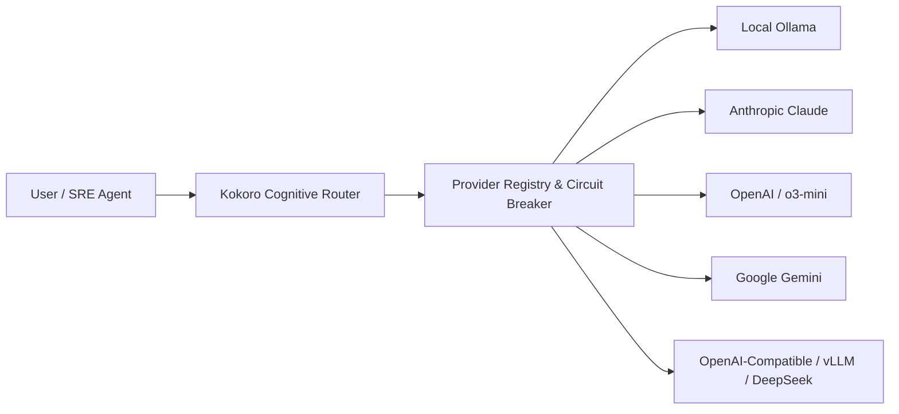

# 🌐 SAORI KOKORO — AI Providers & Multi-Model Routing

SAORI Kokoro is designed with **sovereign model decoupling**. You are never locked into a single AI provider, vendor API, or cloud account.

---

## 🧭 Multi-Provider Architecture

SAORI includes built-in adapters for 5 distinct model topologies:



---

## 1. 🦙 Local Ollama (100% Free & Private)

Run state-of-the-art open-source models completely offline on your own machine. Zero cloud costs, zero privacy concerns.

### Setup:
1. Install Ollama from [ollama.com](https://ollama.com).
2. Pull your model of choice:
   ```bash
   ollama run llama3.2
   # or for coding:
   ollama pull qwen2.5-coder:7b
   ```
3. In your `.env`:
   ```bash
   SAORI_PRIMARY_PROVIDER=ollama
   OLLAMA_BASE_URL=http://localhost:11434
   OLLAMA_MODEL=llama3.2
   ```

### Discovered Capabilities:
- Chat completions, system instructions, streaming.
- Auto-discovers all locally installed models via `/api/tags`.

---

## 2. 🏛️ Anthropic Claude

Recommended for high-precision architecture signoffs, security policy reviews, and peer consulting.

### Setup:
1. Obtain an API key from [console.anthropic.com](https://console.anthropic.com).
2. In your `.env`:
   ```bash
   SAORI_PRIMARY_PROVIDER=anthropic
   ANTHROPIC_API_KEY=sk-ant-api03-...
   ANTHROPIC_MODEL=claude-3-5-sonnet-20241022
   ```

### Available Models:
- `claude-3-5-sonnet-20241022` — Deep reasoning and SRE code architecture.
- `claude-3-5-haiku-20241022` — Ultra-fast routine triage.
- `claude-3-opus-20240229` — Formal verification and critical policy auditing.

---

## 3. ⚙️ OpenAI Direct

Recommended for balanced code generation, continuous integration tasks, and automated testing.

### Setup:
1. Obtain an API key from [platform.openai.com](https://platform.openai.com).
2. In your `.env`:
   ```bash
   SAORI_PRIMARY_PROVIDER=openai
   OPENAI_API_KEY=sk-proj-...
   OPENAI_MODEL=gpt-4o-mini
   ```

### Available Models:
- `gpt-4o` — Multimodal analysis and complex refactors.
- `gpt-4o-mini` — Lightweight, cost-effective routine operational tasks.
- `o3-mini` / `o1` — High-tier reasoning for algorithmic and edge-case resolution.

---

## 4. ⚡ Google Gemini

Recommended for massive context analysis (up to 2M tokens) and low-latency telemetry processing.

### Setup:
1. Obtain an API key from [Google AI Studio](https://aistudio.google.com).
2. In your `.env`:
   ```bash
   SAORI_PRIMARY_PROVIDER=gemini
   GEMINI_API_KEY=AIzaSy...
   GEMINI_MODEL=gemini-2.0-flash
   ```

### Available Models:
- `gemini-2.0-flash` — Sub-second latency, optimal for real-time telemetry indexing.
- `gemini-1.5-pro` — 2M token context window for full codebase graph analysis.

---

## 5. 🔌 OpenAI-Compatible Endpoints (vLLM, LocalAI, DeepSeek, Groq)

Connect to self-hosted enterprise model servers or third-party inference providers adhering to the standard OpenAI API specification.

### Setup:
```bash
SAORI_PRIMARY_PROVIDER=openai
OPENAI_COMPATIBLE_BASE_URL=http://your-vllm-server:8000/v1
OPENAI_COMPATIBLE_API_KEY=your_key_or_none
OPENAI_COMPATIBLE_MODEL=deepseek-r1
```

---

## 🛡️ Circuit Breakers & Failover Chain

If your primary provider encounters a rate limit (HTTP 429) or connection failure:
1. The **Circuit Breaker** records the error and opens after 3 consecutive failures to prevent thread starvation.
2. The **Dynamic Fallback Chain** automatically switches to the next configured provider:
   ```text
   Primary (Anthropic) ──[Fail]──> Secondary (OpenAI) ──[Fail]──> Local Ollama ──[Fail]──> Offline Mode
   ```
3. Full black-box failure context is logged into the **Flight Recorder** for post-mortem analysis.
