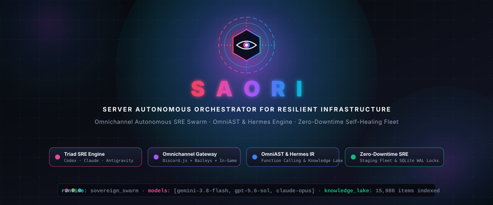
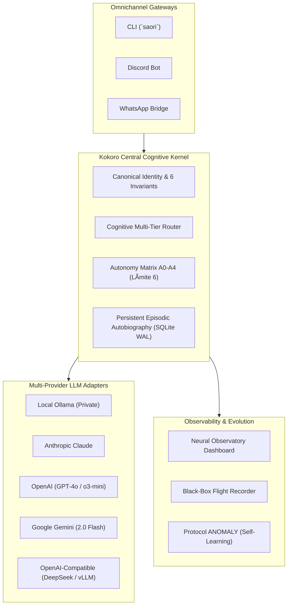

<div align="center">



# �� S.A.O.R.I. — Autonomous Multi-Agent SRE Framework
### **Server Autonomous Orchestrator for Resilient Infrastructure**
*Production-Grade Omnichannel SRE Swarm, Kokoro Kernel, Neural Observatory & Protocol ANOMALY*

[](https://www.python.org/)
[](https://nodejs.org/)
[](https://discord.js.org/)
[](https://github.com/WhiskeySockets/Baileys)
[](ARCHITECTURE.md)
[](docs/OBSERVATORY.md)
[](docs/KOKORO_ANOMALY.md)
[](https://sqlite.org/)
[](PROVIDERS.md)
[](LICENSE)

[Quickstart](INSTALL.md) • [Providers](PROVIDERS.md) • [Architecture](ARCHITECTURE.md) • [Neural Observatory](docs/OBSERVATORY.md) • [Protocol ANOMALY](docs/KOKORO_ANOMALY.md) • [Security](SECURITY.md) • [Contributing](CONTRIBUTING.md)

</div>

---

> [!NOTE]
> **Language Standard Notice:** While the author's native language is Spanish, this documentation is written in English to adhere to international open-source software engineering standards and enable seamless cross-model interoperability across global AI agents and developers. A [Spanish Summary](#-resumen-en-espa%C3%B1ol) is provided at the bottom of this document.

---

## 🌟 Vision & What SAORI Solves

Modern server fleets, cloud infrastructures, and community platforms suffer from operational fragmentation:
- Incident alerts are scattered across disparate channels (Discord, WhatsApp, monitoring webhooks).
- AI agents often act as ungrounded chatbots without deterministic audit trails, black-box flight recorders, or strict permission boundaries.
- Engineers are tied to proprietary vendor APIs and closed ecosystem locks.

**SAORI** (*Server Autonomous Orchestrator for Resilient Infrastructure*) solves this by providing a **production-ready, self-hosted, sovereign SRE swarm framework**. It unifies:
1. **Omnichannel Interaction:** Operates simultaneously over CLI, Discord modals, WhatsApp bridges, and game server consoles.
2. **Universal Multi-Provider LLM Engine:** Plugs seamlessly into **local Ollama (100% private & free)**, **Anthropic Claude**, **OpenAI**, **Google Gemini**, or **OpenAI-compatible** servers (vLLM, DeepSeek, LocalAI).
3. **Neural Observatory & Flight Recorder:** Deterministic black-box logging that records causal chains (`TRIGGER` âž” `CONTEXT` âž” `MODEL` âž” `TOOL` âž” `RESULT`) and enables instantaneous post-mortem replay.
4. **Protocol ANOMALY (AST-0001):** Verifiable cognitive self-improvement using scientific hypotheses, an ephemeral sandbox, and a strict $+15\%$ meta-learning promotion threshold.
5. **Autonomy Matrix (A0–A4) & Límite 6:** Rigorous separation of powers ensuring that high-risk production changes strictly require human authorization.

> [!IMPORTANT]
> **Clean-Room Architecture (Zero Secret Leaks):**  
> This public framework contains **zero private credentials, zero hardcoded tokens, zero personal telephone numbers, and zero private infrastructure IPs**. All identity directives, access roles, and provider endpoints are dynamically configured via environment variables and `.env` templates.

---

## 🚀 Key Architectural Pillars



### 1. Kokoro Cognitive Kernel (`kokoro/`)
- **Canonical Persona:** Enforces non-destruction, radical technical veracity, token economy, and domain isolation.
- **Autonomy Matrix A0–A4:**
  - `A0 (Observer)`: Read-only telemetry, log analysis, and AST queries.
  - `A1 (Routine Recovery)`: Automated clearance of stale locks and sandbox resets.
  - `A2 (Reversible Improvement)`: Auto-testing and patching inside isolated sandboxes.
  - `A3 (Supervised / Límite 6)`: Production deploys, database wipes, and credential changes strictly require human signoff.
  - `A4 (Emergency Contained)`: Outage containment and immediate human escalation.
- **Persistent Autobiography:** Automatic local SQLite database in WAL mode (`~/.local/state/saori/memory.db`) with fallback sync to external MCP/REST memory services.

### 2. Universal Multi-Provider Adapters (`kokoro/adapters/`)
- Switch providers dynamically via `SAORI_PRIMARY_PROVIDER` in `.env`.
- Built-in **Circuit Breakers** and **Failover Chains**: if your primary provider encounters rate limits or outages, SAORI automatically cascades to secondary providers or local Ollama without crashing your service.

### 3. Neural Observatory & Flight Recorder (`kokoro/observatory/`)
- **Live SRE Web UI:** Real-time monitoring of agent PIDs, RSS memory, CPU ticks, and task liveness at `http://127.0.0.1:8089`.
- **Flight Recorder Black Box:** Records every operational step. Run `saori flight --replay <trace_id>` to generate a complete Markdown audit report.
- **Stratified Event Retention:** Stratified TTL and count caps (telemetry 24h/1k, operations 7d/3k, decisions 30d/10k, incidents 90d/10k) with a hard 30 MB disk storage cap.
- **Secret Sanitization Engine:** Regex and structural key redaction strips sensitive tokens prior to disk persistence.

### 4. Protocol ANOMALY AST-0001 (`kokoro/anomaly/`)
- Dynamic Self-Model health score (0–100).
- Scientific hypothesis formulation with falsification criteria.
- Ephemeral sandbox execution (`~/.local/state/saori/anomaly/sandbox/`).
- Meta-learning comparison: challenger strategies are only promoted if they demonstrate $\ge 15\%$ gain with zero invariant breaches.

---

## âš¡ 1-Minute Quickstart

### Automated Installer (Linux / macOS)
```bash
git clone https://github.com/JackStar6677-1/saori.git
cd saori
chmod +x install.sh
./install.sh
```

### Manual Setup (All Platforms)
```bash
git clone https://github.com/JackStar6677-1/saori.git
cd saori
python3 -m venv .venv
source .venv/bin/activate  # On Windows: .venv\Scripts\Activate.ps1
pip install -e .
```

### Initial Configuration Wizard
Run the interactive setup wizard to configure your preferred LLM provider:
```bash
saori init
```

### Run System Health Check
Verify Python, SQLite WAL storage, and AI provider connectivity:
```bash
saori doctor
```

---

## 💻 CLI Command Reference

| Command | Description |
|---|---|
| `saori doctor` | Runs full environment, dependency, and AI provider diagnostics |
| `saori status` | Displays Kokoro health score, active invariants, and provider status |
| `saori init` | Interactive onboarding wizard to create/update `.env` configuration |
| `saori chat` | Interactive conversational terminal session with SAORI SRE |
| `saori observatory` | Launches the Neural Observatory web dashboard (default port 8089) |
| `saori flight` | Lists recent black-box execution traces |
| `saori flight --replay <id>` | Deterministically reconstructs and prints the causal timeline of a trace |
| `saori anomaly --cycle` | Executes an autonomous cognitive self-learning cycle |
| `saori anomaly --hypotheses`| Lists active scientific hypotheses |
| `saori anomaly --learnings`  | Displays verified meta-learnings and performance gains |

---

## 📚 Documentation Index

- 📖 **[Installation Guide (INSTALL.md)](INSTALL.md):** Detailed Linux, macOS, Windows, and Docker guides.
- � **[AI Providers Guide (PROVIDERS.md)](PROVIDERS.md):** Setup instructions for Ollama, Anthropic, OpenAI, Gemini, and vLLM.
- �� **[Architecture Specification (ARCHITECTURE.md)](ARCHITECTURE.md):** Deep architectural breakdown of Kokoro, SRE swarms, and memory.
- 🔭 **[Neural Observatory (docs/OBSERVATORY.md)](docs/OBSERVATORY.md):** Flight recorder causality, stratified retention, and daemon security.
- 🧬 **[Protocol ANOMALY (docs/KOKORO_ANOMALY.md)](docs/KOKORO_ANOMALY.md):** Scientific hypothesis engine, simulation sandbox, and meta-learning.
- 🔒 **[Security Policy (SECURITY.md)](SECURITY.md):** Zero-leak standards, reporting vulnerabilities, and sanitization.
- � **[Contributing Guidelines (CONTRIBUTING.md)](CONTRIBUTING.md):** How to contribute safely to the monorepo.
- � **[Changelog (CHANGELOG.md)](CHANGELOG.md):** Version history and release notes.

---

## 🇨🇱 Resumen en Español

**SAORI** (*Server Autonomous Orchestrator for Resilient Infrastructure*) es un framework autónomo de Ingeniería de Confiabilidad de Sitios (SRE) y orquestación multi-agente de código abierto.

Permite a cualquier equipo de ingeniería desplegar una flota autónoma 24/7 conectada a **Discord, WhatsApp, consolas de servidores de juegos y APIs web**, respaldada por el **Núcleo Cognitivo Kokoro**:
- **Multiproveedor Desacoplado:** Compatible con Ollama local (100% privado y sin costo de tokens), Claude de Anthropic, OpenAI, Google Gemini y servidores compatibles con OpenAI (vLLM, DeepSeek).
- **Neural Observatory & Caja Negra:** Registra cada decisión, llamada a herramienta y consumo de tokens con reconstrucción determinista (`saori flight --replay`).
- **Protocolo ANOMALY:** Motor de autoaprendizaje verificable mediante formulación de hipótesis científicas y pruebas en sandbox aislado.
- **Matriz de Autonomía A0–A4 & Límite 6:** Los cambios destructivos en producción requieren siempre autorización humana explícita.
- **Cero Filtraciones:** Arquitectura limpia sin credenciales, IPs privadas ni datos personales en el repositorio.

---

## 📄 License

SAORI is released under the permissive [MIT License](LICENSE).  
Copyright © 2026 JackStar Systems.
