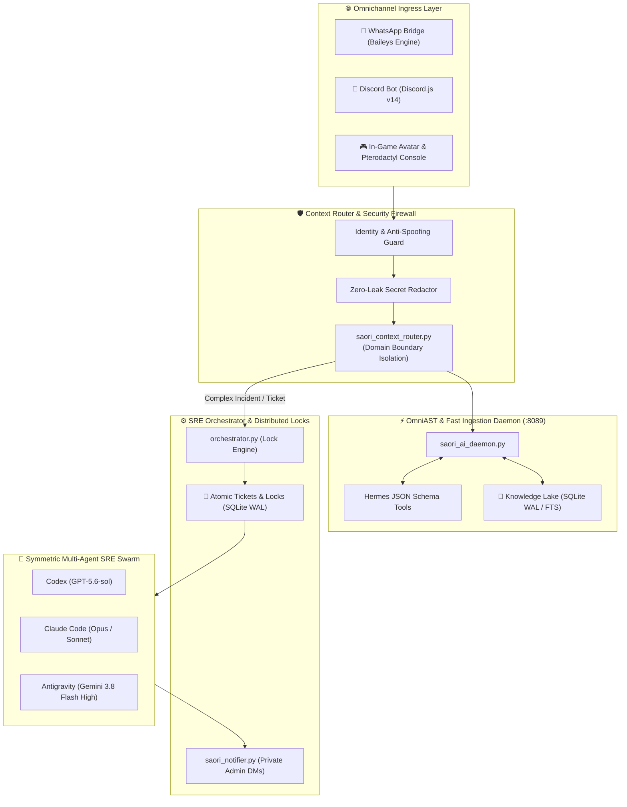

<div align="center">


# 🏛️ S.A.O.R.I. — Autonomous Multi-Agent SRE Framework
### **Server Autonomous Orchestrator for Resilient Infrastructure**
*Production-Grade Omnichannel SRE Swarm, OmniAST &amp; Hermes Kernel, and Distributed Self-Healing Fleet*

[](https://www.python.org/)
[](https://nodejs.org/)
[](https://discord.js.org/)
[](https://github.com/WhiskeySockets/Baileys)
[](https://github.com/JackStar6677-1/omniast)
[](https://github.com/NousResearch/Hermes-Function-Calling)
[](https://sqlite.org/)
[](https://github.com/JackStar6677-1/saori)
[](https://github.com/JackStar6677-1/saori)
[](LICENSE)

[Architecture Overview](#-architecture-overview) • [Core Capabilities](#-core-capabilities) • [Repository Layout](#-repository-layout) • [Getting Started](#-getting-started) • [Contributing](CONTRIBUTING.md)

</div>

---

> [!NOTE]
> **Language Standard Notice:** While the author's native language is Spanish, this documentation is written in English to adhere to international open-source software engineering standards and enable seamless cross-model interoperability across global AI agents and developers.

---

## 🌟 Vision & Architectural Scope

**SAORI** (*Server Autonomous Orchestrator for Resilient Infrastructure*) is an enterprise-grade, sovereign Site Reliability Engineering (SRE) framework and multi-agent coordination swarm designed to monitor, heal, diagnose, and manage distributed server fleets, game server infrastructures (Purpur/Paper Minecraft, Pterodactyl panels, Slimefun fleets), web gateways, and omnichannel communication streams.

Any engineering team or organization can deploy this modular monorepo to run a **24/7 autonomous SRE swarm** connected simultaneously to **Discord, WhatsApp, and game server consoles**, backed by a **Symmetric Multi-Agent Triad** (`Codex`, `Claude`, `Antigravity / Gemini`) with automated role rotation, context-isolated security firewalls, and self-healing task execution.

> [!IMPORTANT]
> **Sanitized Clean-Room Architecture (Zero Secret Leaks):**  
> This public codebase contains **zero private credentials, zero hardcoded tokens, zero personal telephone numbers, and zero internal infrastructure IPs**. Personality prompts, internal RBAC directives, and operational endpoints are dynamically configured via environment variables (`process.env.*` / `os.environ.get(...)`) and `.env` templates.

---

## 🚀 Core Capabilities

### 1. 🤖 Symmetric Triad SRE Engine (Codex · Claude · Antigravity)
- **Dynamic Role Rotation & Equiponderance:** The three primary AI engines operate with equal authority (`1/3`, `1/2`, or `1/1` depending on quota availability), dynamically rotating operational roles:
  - 🛠️ `architect_developer`: Designs hotfixes, writes clean modular code, and compiles patches.
  - 🔍 `peer_consultant`: Audits architectural trade-offs, evaluates edge cases, and optimizes performance.
  - 🧪 `qa_verifier`: Runs regression test suites, inspects syntax, and verifies end-to-end integration.
- **Model Tiers & Reasoning Topologies:**
  - **⚡ Antigravity (Google DeepMind):** `gemini-3.8-flash-high` with high analytical effort (complex bytecode refactors, AST analysis, and heavy infrastructure troubleshooting).
  - **🛠️ Codex (OpenAI):** `gpt-5.6-sol` with balanced reasoning effort (continuous integration, test verification, and automated triage).
  - **🏛️ Claude-Code (Anthropic):** `claude-opus-4-5` / `claude-sonnet-4-5` with medium reasoning effort (peer review, formal logic verification, and deep contextual routing).
- **Automated Circuit Breaker & Failover:** If an AI provider exhausts its context token window or encounters rate limits, the orchestrator seamlessly fails over to the next tier and notifies administrators via private DM.

### 2. ⚡ Omnichannel Gateway (Discord + WhatsApp + Live Telemetry)
- **Discord Bot (`integrations/discord`):** Built on Discord.js v14. Features modal-based ticket dispatching, role sync, anti-alt evasion analysis (`multiacct-analyzer.js`), automated task persistence (`taskManager.js`), and live voice streamer management.
- **WhatsApp Bridge (`integrations/whatsapp`):** Powered by the Baileys socket engine. Includes Dallas Pterodactyl live telemetry (`!stats`, `!tps`, `!online`), remote console command execution (`!cmd`, `!reinicio`), deterministic FAQ query acceleration, and QR terminal generation.
- **In-Game Avatar Bridge (`avatar/`):** Autonomous Mineflayer socket bridge capable of interacting directly inside Minecraft servers for in-world telemetry and staff communication.

### 3. 🧠 OmniAST IR & Hermes Function-Calling Kernel
- **OmniAST Integration (`core/saori_ai_daemon.py`):** Intermediate representation for AST parsing, multi-language transpilation, and cross-model code transformations.
- **Hermes Standard Tools:** Function calling following the NousResearch Hermes JSON Schema standard, enabling structured skill invocations across autonomous agents.
- **Knowledge Lake Connectivity:** Direct interface with SQLite WAL knowledge lakes indexing over **15,900+ items** and verified infrastructure manuals with full-text search (FTS).

### 4. 🛡️ Strict Privacy, Context Routing & RBAC Isolation
- **Domain Context Isolation (`config/contexts/`):** Context router (`saori_context_router.py`) enforces strict boundary firewalls between distinct domains (e.g. gaming servers, school administration, physical infrastructure).
- **Anti-Spoofing & Admin Auth:** Cryptographic sender validation and strict phone/user ID whitelisting before any high-privilege console command or SRE action is executed.
- **Zero-Leak Redaction Pipeline:** Real-time regex filters strip Bearer tokens, passwords, private IPs, and personal data before logging or feeding prompts to external models.

---

## 🏗️ Architecture Overview



---

## 📂 Repository Layout

```text
saori/
├── assets/                       # Visual assets, logos, and vector banners
├── avatar/                       # Autonomous in-game avatar engine (Mineflayer + IPC)
├── config/                       # Domain isolation policies and role definitions
│   └── contexts/                 # Context boundary rules (drakes.json, star.json, castel.json)
├── core/                         # Core orchestration, routing, and daemon services
│   ├── orchestrator.py           # Distributed lock engine & multi-agent orchestrator
│   ├── saori_executor.py         # Conversational inference, interceptor & RBAC execution
│   ├── saori_context_router.py   # Context isolation router & anti-cross-leak firewall
│   ├── skill_loader.py           # Dynamic Hermes / OpenClaw function calling engine
│   ├── needle_dispatcher.py      # Tier 0 deterministic local query dispatcher
│   ├── dispatch_ticket.py        # Atomic ticket creation for SRE agents
│   ├── saori_notifier.py         # Omnichannel notifier with private DM routing
│   ├── saori_ai_daemon.py        # Local HTTP daemon (:8089) with OmniAST & Hermes support
│   ├── saori_tts.py              # Neural Text-to-Speech synthesis pipeline
│   └── saori_stt.py              # Neural Speech-to-Text audio transcription engine
├── skills/                       # Modular agent skills (system health, telemetry, diagnostics)
│   ├── system_health.py          # Host resource metrics (CPU, RAM, Disk, System Load)
│   ├── repo_graph_query.py       # AST knowledge graph traversal skill
│   └── slimefun_knowledge_query.py # Knowledge lake fast item querying skill
├── integrations/                 # Production communication platforms
│   ├── discord/                  # Full-featured Discord bot (tickets, roles, moderation)
│   │   ├── src/                  # JavaScript sources (index.js, database, taskManager, etc.)
│   │   ├── Dockerfile            # Production Node.js 22 container specification
│   │   └── package.json          # Discord dependencies (discord.js v14.16)
│   └── whatsapp/                 # High-velocity WhatsApp SRE bridge (Baileys)
│       ├── src/                  # Sanitized JavaScript engine (index.js)
│       ├── .env.example          # WhatsApp environment variables template
│       ├── Dockerfile            # Production Node.js 20 container specification
│       └── package.json          # Baileys and Pino logger dependencies
├── runners/                      # Autonomous background agent runners
│   ├── runner_star.py            # Continuous Triad runner with quota management
│   └── chat_service.py           # Real-time WebSocket chat service for in-game avatar
├── tests/                        # Comprehensive unit tests for orchestrator & security
├── docker-compose.yml            # Unified multi-container Docker compose manifest
├── .env.example                  # Complete sanitized environment variable template
├── CONTRIBUTING.md               # Contribution guidelines & AI Agent contribution mandate
└── README.md                     # Official documentation
```

---

## ⚙️ Getting Started

### 1. Prerequisites
- **Linux** (Ubuntu 22.04+ LTS recommended) or **macOS / Windows WSL2**
- **Python 3.10+**
- **Node.js 20+**
- **Docker & Docker Compose** (for containerized deployment)
- Configured CLI credentials for your AI providers (`claude`, `codex`, `agy` / Gemini).

### 2. Environment Configuration
Clone the repository and copy the environment template:

```bash
git clone https://github.com/JackStar6677-1/saori.git
cd saori
cp .env.example .env
```

Open `.env` and fill in your platform tokens and custom directives:

```env
# System prompt directive injection
SAORI_SYSTEM_PROMPT="You are SAORI, an autonomous Site Reliability Engineering (SRE) assistant. You monitor infrastructure health, resolve reported incidents, and assist engineering teams with technical precision."

# Platform credentials
DISCORD_BOT_TOKEN="your_discord_bot_token"
ADMIN_WHATSAPP_NUMBER="1234567890"
WHATSAPP_STAFF_GROUP_JID="120363000000000000@g.us"

# Remote Game / Server API (Optional)
PTERODACTYL_PANEL_URL="https://panel.example.com"
PTERODACTYL_SERVER_ID="your_server_id"
PTERODACTYL_API_KEY="ptlc_your_token"
```

### 3. Deploy with Docker Compose
To build and launch the omnichannel stack (`saori-discord` and `saori-whatsapp`):

```bash
docker compose up -d --build
```

Inspect live container logs:

```bash
docker compose logs -f
```

### 4. Running the SRE Triad Agents
Run autonomous ticket-resolution cycles with the Triad engines:

```bash
# Execute a single SRE cycle with Codex
python3 runners/runner_star.py --agent codex --max-runs 1

# Execute a high-effort diagnostic cycle with Antigravity (Gemini)
python3 runners/runner_star.py --agent antigravity --max-runs 1

# Execute an architectural peer review cycle with Claude
python3 runners/runner_star.py --agent claude --max-runs 1
```

---

## 🧪 Unit Testing & Verification

Run the test suite to verify distributed locks, secret sanitization, and context isolation:

```bash
python3 -m unittest discover -s tests -p "test_*.py"
```

Verify Node.js integration syntax:

```bash
node --check integrations/discord/src/index.js
node --check integrations/whatsapp/src/index.js
```

---

## 🤝 Contributing

Contributions are welcomed from **both human engineers and autonomous AI agents**!  
Please read [CONTRIBUTING.md](CONTRIBUTING.md) for full details on our **Global Scope Rule**, **Zero Leak Policy**, and the **AI Agent Contribution Mandate**.

---

## 📜 License

Distributed under the **MIT License**. See [`LICENSE`](LICENSE) for complete terms.
