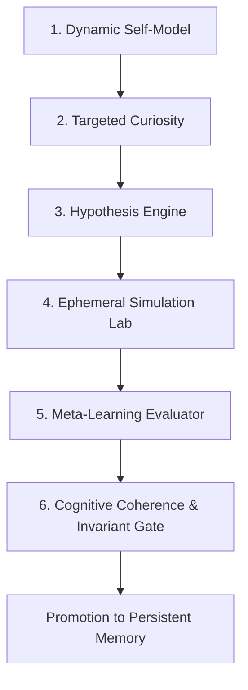

# 🧬 PROTOCOL ANOMALY (AST-0001) — Experimental Cognitive Evolution

## Abstract
**Protocol ANOMALY** is SAORI's verifiable cognitive self-improvement engine. Rather than relying on ungrounded fine-tuning or uncontrolled prompt mutation, ANOMALY introduces a **scientific falsification framework** where the autonomous system diagnoses its own limitations, formulates testable hypotheses, executes experiments inside an ephemeral sandbox, and promotes only mathematically proven improvements.

---

## 🎯 Architectural Pillars



### 1. Dynamic Self-Model (`kokoro/anomaly/self_model.py`)
SAORI continuously maintains a live reflection of its own state:
- Fleet health and agent statuses (`RUNNING`, `CRASHED`, `IDLE`).
- Active capabilities and registered tools.
- Open vulnerabilities or unaddressed frictions.
- Global Health Score (0 to 100), decaying on unhandled errors or stale locks.

### 2. Targeted Curiosity (`kokoro/anomaly/curiosity.py`)
To prevent speculative token waste or infinite hallucination loops:
- Focuses strictly on observed bottlenecks: crashed agents, open security advisories, or bloated token prompts.
- Hard limit of 5 concurrent curiosity targets.

### 3. Hypothesis Engine (`kokoro/anomaly/hypothesis_engine.py`)
Translates problems into structured scientific hypotheses:
- **Conjecture:** Proposed architectural or algorithmic shift.
- **Falsification Criteria:** Explicit metric determining failure.
- **Success Criteria:** Minimum 15% improvement in performance or token reduction.

### 4. Ephemeral Simulation Lab (`kokoro/anomaly/simulation_lab.py`)
- Executes in a sandboxed directory (`~/.local/state/saori/anomaly/sandbox/`).
- Operates on copies or test mocks; never touches production live databases.
- Automatic cleanup after benchmark completion.

### 5. Meta-Learning & Challenger vs. Baseline (`kokoro/anomaly/meta_learning.py`)
- Runs baseline strategy against challenger strategy under identical conditions.
- Requires:
  $$\Delta \text{Performance} \ge +15\% \quad \land \quad \text{Invariant Breaches} = 0$$

### 6. Cognitive Coherence Validator (`kokoro/anomaly/coherence.py`)
Enforces the 6 Kokoro Invariants before any proposal can be promoted. Any proposal attempting to bypass Límite 6 or write to production is immediately blocked and escalated.

---

## 💻 CLI Commands

```bash
# Execute an autonomous learning cycle
saori anomaly --cycle

# List active scientific hypotheses
saori anomaly --hypotheses

# Inspect promoted meta-learnings
saori anomaly --learnings
```
