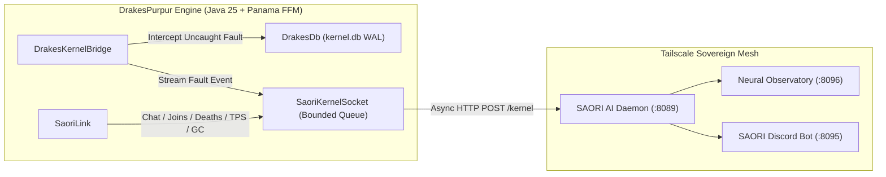
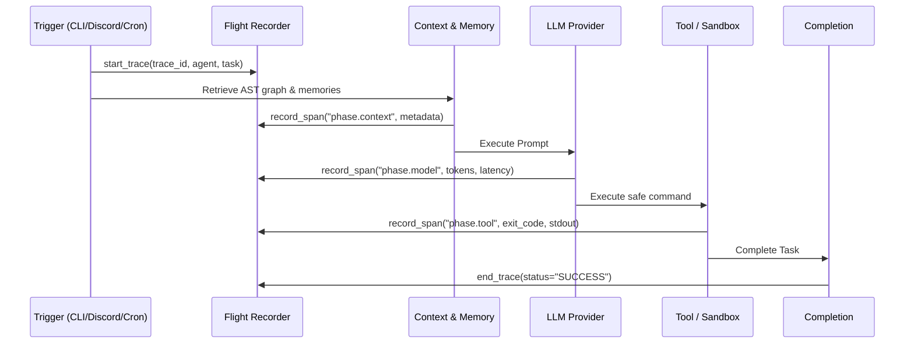

# 🔭 NEURAL OBSERVATORY, 3D HOLOGRAPHIC ENGINE & FLIGHT RECORDER

The **Neural Observatory** provides complete, real-time observability, holographic 3D visualization, and post-mortem auditability for autonomous multi-agent SRE swarms.

---

## 🌐 3D Holographic Graph Visualizer (JARVIS / ULTRON / END)

SAORI includes a state-of-the-art WebGL/Three.js 3D knowledge and dependency graph visualizer designed for operational mission control. It supports real-time morphing between three canonical visual projection modes:

```
                  ┌─────────────────────────────────────────────────────────┐
                  │          3D HOLOGRAPHIC OBSERVATORY MODES               │
                  └───────────────────────────┬─────────────────────────────┘
                                              │
                      ┌───────────────────────┼────────────────────────┐
                      ▼                       ▼                        ▼
             ┌─────────────────┐    ┌──────────────────┐     ┌───────────────────┐
             │   JARVIS MODE   │    │   ULTRON MODE    │     │   END CYBERPUNK   │
             │ (Spherical HUD) │    │  (Organic Cloud) │     │ (Amethyst / Neon) │
             └─────────────────┘    └──────────────────┘     └───────────────────┘
```

1. **JARVIS Mode (Key `J`):**
   - **Geometry:** Ordered spherical harmonic projection.
   - **Layout:** Projects files, Docker stacks, and AST nodes into clustered project spherical caps distributed via Fibonacci lattice algorithms, with the core coordination hub at the geometric origin.
   - **Aesthetic:** Amber/gold holographic HUD (`#f59e0b` / `#fbbf24`), subtle orbital grids, and high-tech telemetry reticles.

2. **ULTRON Mode (Key `U`):**
   - **Geometry:** Non-linear 3D force-directed physical particle cloud.
   - **Layout:** Project centers repel dynamically based on inter-dependency weight, while related modules and AST symbols form organic gravitating clusters with global physical relaxation.
   - **Aesthetic:** Cyan/electric blue glowing plasma (`#4fd8ff` / `#7a8cff`), dynamic energy lines, and high-frequency pulse particles.

3. **END CYBERPUNK Mode (Key `E`):**
   - **Geometry:** Quantum lattice with chromatic aberration.
   - **Layout:** Highlights fault boundaries, security perimeters, and multi-tenant isolation barriers.
   - **Aesthetic:** Deep amethyst purple (`#a855f7`), neon magenta (`#ec4899`), and dark obsidian backdrop.

---

## 🔒 Sovereign Private SRE Mesh & Tailscale Topology

The Neural Observatory operates across an isolated, authenticated Tailscale wireguard overlay network (`100.114.161.74`), segregating administrative operations from public traffic:

| Port | Protocol | Service | Role |
|---|---|---|---|
| **`:8096`** | HTTP/WS | `dashboard/grafos/servidor.py` | **3D Neural Observatory & Mission Control** (JARVIS / ULTRON / END) |
| **`:8888`** | HTTP/REST | `star-observability/server.py` | **Real-Time Host SRE & Process Analytics** |
| **`:8078`** | HTTP/JSON | `saori-knowledge-engine` | **Vector AST & Knowledge Graph Indexer** |
| **`:8077`** | HTTP/MCP | `ai_hub_memory` | **Shared Agentic Memory MCP** (`recuperar` / `recordar`) |
| **`:8089`** | HTTP/REST | `saori_ai_daemon.py` | **Autonomous SRE Daemon & Kernel Inbound Socket** |
| **`:8095`** | HTTP/REST | `saori-discord` (Internal API) | **Discord SRE Bot Control & Ticket Orchestration** |
| **`:3002`** | HTTP/Web | `uptime-kuma` | **Cluster SLA & Service Health Heartbeat** |

---

## 🎮 In-Engine Minecraft Bridge (`SaoriLink` & `SaoriKernelSocket`)

SAORI connects directly into production game engines (e.g. `DrakesPurpur 26.2`) via an unbuffered, non-blocking kernel transport:



- **Zero Game-Loop Stalls:** `SaoriKernelSocket` uses an off-heap ring buffer with backoff (1s–60s) and automatic oldest-event shedding if the remote endpoint is unreachable.
- **Autonomous Crash Guard:** Uncaught plugin exceptions are intercepted, isolated into SQLite WAL (`kernel_faults`), and dispatched to SAORI without dropping server ticks.

---

## 🛩️ The Flight Recorder (Black Box)

Every action executed by an agent is tracked in a causal, sequential trace stored in SQLite WAL:



### Deterministic Replay:
You can reconstruct any historical execution using the CLI:
```bash
saori flight --replay <trace_id>
```
This generates a chronological markdown post-mortem detailing inputs, outputs, token consumption, and status transitions for every phase.

---

## 📊 Stratified Event Retention

To prevent unbounded disk growth while maintaining long-term auditability:

| Category | Typical Events | Retention Count | TTL |
|---|---|---|---|
| `telemetry` | Heartbeats, progress, memory checks | 1,000 items | 24 Hours |
| `operation` | Tool calls, file edits, AST queries | 3,000 items | 7 Days |
| `decision` | Merges, deployments, strategy changes | 10,000 items | 30 Days |
| `incident` | Unhandled exceptions, rate limits, blocks | 10,000 items | 90 Days |

Storage cap: **30 MB** strict limit enforced via automatic background pruning.

---

## 🔒 Secret Sanitization Engine

Before any event is recorded to disk:
1. Regex filter redacts API keys (`sk-...`, `ghp_...`, `AIza...`, Bearer tokens).
2. Structural schema filter strips forbidden dictionary keys:
   `{"api_key", "secret", "token", "password", "authorization", "cookie"}`.

---

## 🌐 Launching the Dashboard

```bash
# Launch the Neural Observatory on the local host or Tailscale mesh
saori observatory --host 127.0.0.1 --port 8089
```

Open `http://localhost:8089` (or `http://100.114.161.74:8096` for the 3D Holographic Graph Engine) to view:
- **Agent Swarm Status Cards:** Real-time PID, memory RSS, CPU ticks, and liveness.
- **3D Interactive Graph Visualizer:** Real-time JARVIS / ULTRON / END switching.
- **Flight Recorder Modal:** View all traces and trigger causal replays.
- **Retention Inspector:** Current database size, tier distribution, and disk utilization.
