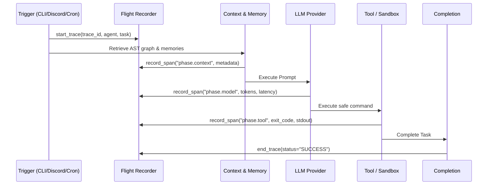

# 🔭 NEURAL OBSERVATORY & FLIGHT RECORDER

The **Neural Observatory** provides complete, real-time observability and post-mortem auditability for autonomous multi-agent swarms.

---

## 🛩� The Flight Recorder (Black Box)

Every action executed by an agent is tracked in a causal, sequential trace stored in SQLite WAL:



### Deterministic Replay:
You can reconstruct any historical execution using the CLI:
```bash
saori flight --replay <trace_id>
```
This generates a chronological markdown post-mortem detailing inputs, outputs, token consumption, and status transitions for every phase.

---

## 📊 Stratified Event Retention

To prevent unbounded disk growth while maintaining long-term auditability:

| Category | Typical Events | Retention Count | TTL |
|---|---|---|---|
| `telemetry` | Heartbeats, progress, memory checks | 1,000 items | 24 Hours |
| `operation` | Tool calls, file edits, AST queries | 3,000 items | 7 Days |
| `decision` | Merges, deployments, strategy changes | 10,000 items | 30 Days |
| `incident` | Unhandled exceptions, rate limits, blocks | 10,000 items | 90 Days |

Storage cap: **30 MB** strict limit enforced via automatic background pruning.

---

## 🔒 Secret Sanitization Engine

Before any event is recorded to disk:
1. Regex filter redacts API keys (`sk-...`, `ghp_...`, `AIza...`, Bearer tokens).
2. Structural schema filter strips forbidden dictionary keys:
   `{"api_key", "secret", "token", "password", "authorization", "cookie"}`.

---

## � Launching the Dashboard

```bash
saori observatory --host 0.0.0.0 --port 8089
```

Open `http://localhost:8089` to view:
- **Agent Swarm Status Cards:** Real-time PID, memory RSS, CPU ticks, and liveness.
- **Flight Recorder Modal:** View all traces and trigger causal replays.
- **Retention Inspector:** Current database size, tier distribution, and disk utilization.
